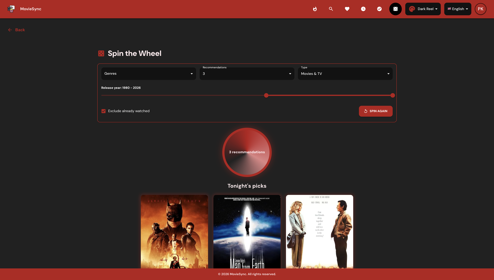
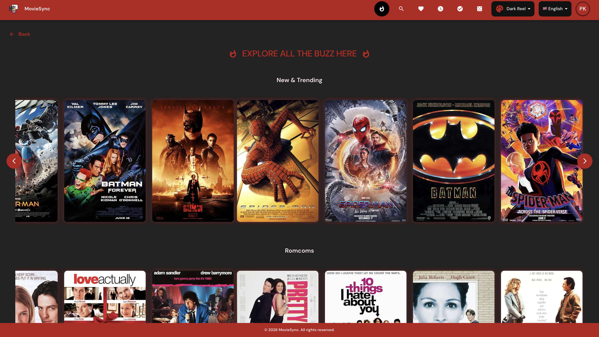

# MovieSync

[](https://github.com/purnimakumarr/moviesync/actions/workflows/ci.yml)

**MovieSync** is a full-stack movie tracking application that I built while learning React and full-stack web development.

The idea is simple: search for movies, explore their details, and keep track of the movies you want to watch, have already watched, or want to save as favourites.

This started as a learning project during my internship and gradually grew into a more complete application with authentication, a backend API, a PostgreSQL database, user profiles, movie statistics, and a few fun features such as a movie recommendation spin wheel.

**Live application:** [MovieSync](https://moviesync-xi.vercel.app)

---

## Project Preview


---

## What can I do with MovieSync?

MovieSync is built around the idea of having one place to manage your personal movie collection.

### Search and explore movies

- Search for movies and TV shows using the TMDB API
- View movie information such as title, poster, genre, plot, ratings, cast, and other available details
- Open a dedicated page for an individual movie
- Browse featured movies

### Keep track of movies

Once logged in, a user can organize movies into different lists:

- **Favourites** – movies you really like
- **Watch Later** – movies you want to watch in the future
- **Watched** – movies you have already watched

This makes the application more useful than a simple movie search page because users can build and manage their own movie collection.

### User profile and statistics

The profile section brings the user's movie activity together in one place.

It includes information and visual statistics based on the movies saved by the user, giving them a quick overview of their movie-watching habits.


### Movie recommendation spin wheel

Sometimes you know you want to watch something but cannot decide what.

MovieSync includes a **Spin Wheel** that can randomly pick movies from the user's saved collection. The user can choose how many recommendations they want and let the wheel decide.

The wheel also has two smarter modes, both running entirely on free, self-hosted tools (no paid AI APIs):

- **Mood search**: type something like *"feel-good heist"* or *"space survival"* and the wheel picks from titles whose plots match the meaning, not just the keywords. Each movie's title, genre and plot are turned into an embedding by a small open-source model ([bge-small-en-v1.5](https://huggingface.co/BAAI/bge-small-en-v1.5)) running inside the API with Transformers.js, and stored in Postgres with **pgvector**. A search is a cosine-similarity query that takes a few milliseconds.
- **A real wheel**: candidate posters and titles sit on an animated wheel that decelerates and stops with the winner under the pointer, followed by a detailed reveal and the rest of the shortlist. It respects the "reduce motion" accessibility setting.
- **Smart Spin** (logged-in users): builds a taste profile from your lists (favourites count most, then watched, then watch later) and makes titles with your favourite genres, directors and actors more likely to come up. Every pick shows why it was chosen, e.g. *"Because you saved 2 films by Christopher Nolan"*.

If the model is unavailable the wheel falls back to random picks instead of failing.



### Authentication

MovieSync supports user authentication and keeps personal movie lists associated with the logged-in user.

The authentication implementation has evolved during development. The current frontend uses an **OpenID Connect (OIDC)** based authentication flow through `react-oidc-context`.

### Multiple languages

The application also includes internationalization using **i18next** and **react-i18next**, allowing the interface to support multiple languages.

---

# Screenshots

## Featured Movies

<!-- Add image here -->



## Search


<!-- ## Movie Details

 -->

## Favourites

<!-- Add image here -->


## Watch Later

<!-- Add image here -->


## Watched Movies

<!-- Add image here -->


## User Profile

<!-- Add image here -->


## Movie Spin Wheel

<!-- Add image here -->


---

# A simplified view of the application

```text
                 ┌─────────────────────┐
                 │      MovieSync      │
                 │   React Frontend    │
                 └──────────┬──────────┘
                            │
                 API requests / responses
                            │
                 ┌──────────▼──────────┐
                 │    Express API      │
                 │   Node + TypeScript │
                 └───────┬───────┬─────┘
                         │       │
              ┌──────────▼─┐   ┌▼─────────────┐
              │ PostgreSQL │   │    TMDB API  │
              │ + pgvector │   │ Movie data   │
              └──────▲─────┘   └──────────────┘
                     │ embeddings
              ┌──────┴──────────────┐
              │ Embedding model     │
              │ (Transformers.js,   │
              │  runs in the API)   │
              └─────────────────────┘
```

The frontend handles the user interface and application state. The backend provides API endpoints and handles database operations, while the TMDB API provides movie and TV information. When a movie is cached, the API also stores an embedding of its plot so the spin wheel can search by mood.

---

# Tech Stack

MovieSync has a separate frontend and backend.

## Frontend

- **React 19** – building the user interface
- **TypeScript** – type-safe development
- **Vite** – development server and build tool
- **Material UI (MUI)** – UI components and styling
- **React Router** – application routing
- **Redux Toolkit** – managing application state
- **Redux Persist** – persisting selected Redux state
- **Axios** – making API requests
- **React i18next / i18next** – internationalization
- **Formik + Yup** – forms and validation
- **MUI X Charts** – charts and statistics
- **Framer Motion** – animations
- **Embla Carousel / Swiper / React Slick** – carousels and sliders

## Backend

- **Node.js** – server-side JavaScript runtime
- **Express** – REST API framework
- **TypeScript** – type-safe backend development
- **PostgreSQL** – relational database
- **node-postgres (`pg`)** – PostgreSQL connection and queries
- **JWT / JWKS** – authentication token verification
- **Axios** – external API communication
- **Express Rate Limit** – basic API rate limiting
- **Swagger** – API documentation
- **Nodemon** – development workflow
- **pgvector** – vector similarity search in PostgreSQL
- **Transformers.js** – runs the embedding model locally, no external AI service
- **node-pg-migrate** – versioned SQL migrations

## Testing and tooling

- **Vitest** – test runner for both frontend and backend
- **Supertest** – HTTP integration tests against a real PostgreSQL database
- **React Testing Library** – component tests
- **Docker / Docker Compose** – one-command local stack
- **GitHub Actions** – CI for lint, type checks, tests, builds and the Docker image

## External services

- **TMDB API** – movie and TV information, search, trending and discovery
- **PostgreSQL database** – storing user and movie-related data
- **Vercel** – frontend deployment

---

# Getting started

## With Docker (recommended)

1. Copy the example environment files and fill in your Auth0, TMDB and key values:

   ```bash
   cp backend/.env.example backend/.env
   cp frontend/.env.example frontend/.env
   ```

2. Start everything:

   ```bash
   docker compose up --build
   ```

   This starts PostgreSQL (with pgvector) on port 5433, the API on port 80 (set `API_PORT` to change it) and the frontend on http://localhost:5173. The API applies database migrations on startup and downloads the embedding model (about 33 MB) the first time.

## Without Docker

Requires Node.js 24 and PostgreSQL with the `pgvector` extension (`brew install pgvector` on macOS).

```bash
# backend
cd backend
npm install
npm run migrate              # create or update the database schema
npm run backfill:embeddings  # optional: embed movies cached before mood search existed
npm run serve                # compiles and restarts on changes

# frontend (in another terminal)
cd frontend
npm install
npm run dev
```

## Database migrations

Schema changes live in [`backend/migrations`](backend/migrations) as plain SQL files and are applied with `npm run migrate`. Create a new one with `npm run migrate:create <name>`.

### Moving an existing database from OMDb to TMDB

Saved lists used to be keyed by IMDb ID and are now keyed by TMDB id and media type. A new or empty database needs nothing extra. A database that already has saved movies needs a one-time script between the two TMDB migrations. Back it up first, because the old IMDb IDs are dropped:

```bash
cd backend
pg_dump "<your DATABASE_URL from .env>" > before-tmdb.sql   # check the file is not empty
npm run migrate -- 1           # adds the TMDB columns (only the next migration)
npm run migrate:tmdb-ids       # looks up every saved title on TMDB
npm run migrate                # makes the TMDB ids the keys
```

The script removes titles that TMDB does not know and lists them. If a request fails, for example because of a network error, it removes nothing; run it again. The last migration refuses to run while any row is still missing its TMDB id. The Docker image runs `npm run migrate` on start, so with Docker the API will not start until these steps are done. Use `docker compose run --rm api npx node-pg-migrate up 1 -m migrations`, then `docker compose run --rm api node dist/scripts/migrateToTmdb.js`, then start as usual.

---

# Testing

```bash
cd backend && npm test    # integration tests; needs a PostgreSQL test database
cd frontend && npm test   # unit and component tests
cd frontend && npm run test:e2e   # responsive checks in a real browser (Playwright)
```

The responsive suite builds the app, mocks the API and opens every main page (including signed-in pages, via a stored test session) at seven screen sizes from 360px phones to 1920px desktops. It fails if anything causes horizontal scrolling or if any visible text is smaller than 12px, and saves a screenshot of each page and size.

Backend tests run against a real PostgreSQL database (`moviesync_test` by default, or `TEST_DATABASE_URL`). They sign their own JWTs and encrypt request bodies exactly like the frontend, so the real authentication and decryption middleware is exercised. The embedding model is mocked so tests never download it. Add `:coverage` (e.g. `npm run test:coverage`) for a coverage report.

GitHub Actions runs linting, type checks, both test suites, the production builds and a Docker build on every push and pull request.

---

# Security notes

- **User identity comes from the verified token, never from the request body.** An earlier version trusted a `userID` field sent by the browser, which would have let a logged-in user read or change someone else's lists. The API now verifies the Auth0 access token and a signed ID token (same user, same issuer) and takes the email from there. Regression tests check that sending another user's ID in the body has no effect.
- CORS only allows the origins listed in `CORS_ORIGINS`.
- Profile fields are encrypted in the database with `pgcrypto`, and user IDs are stored as SHA-256 hashes.

---

### React and frontend development

- Building reusable React components
- Managing local and global state
- Creating custom hooks
- Using Redux Toolkit for application state
- Working with React Router and nested routes
- Handling asynchronous API calls
- Creating loading and error states
- Building reusable forms and validation
- Creating responsive layouts
- Working with charts and visualizations
- Adding animations and interactive UI elements

### Full-stack development

- Connecting a React frontend to an Express backend
- Designing REST API endpoints
- Structuring controllers, routes, and middleware
- Connecting Node.js to PostgreSQL
- Writing database queries
- Managing user-specific data
- Handling authentication tokens
- Protecting API endpoints
- Handling CORS and rate limiting
- Documenting APIs with Swagger

### Working with external APIs

The project uses the TMDB API for movie data (it started out on the OMDb API). This helped me understand how to work with third-party APIs, transform API responses, handle missing data, and build a UI around data that I do not control.

### Deployment

I also used the project to learn about deploying a full-stack application, configuring environment variables, handling production builds, and troubleshooting issues that only appear after deployment.

---

# Some interesting implementation areas

## State management with Redux Toolkit

MovieSync has several pieces of state that need to be shared across different parts of the application, such as:

- User information
- Favourites
- Watch Later movies
- Watched movies
- Featured movies

Redux Toolkit is used to keep this state organized and make updates predictable.

## Authentication and user initialization

When an authenticated user enters the application, MovieSync initializes the corresponding user in the backend if required and then loads their saved movie lists.

This created a useful real-world example of connecting an authentication system with application-specific user data.

## Movie data and personal data are kept separate

The movie information comes from the TMDB API, while personal actions such as marking a movie as favourite or watched are stored in the application's PostgreSQL database.

This separation is useful because the application does not need to store an entire movie database of its own just to let users maintain personal lists.

---

# Learning Journey

MovieSync started as a project for learning React, but building it exposed me to much more than just React components.

The project evolved through several stages:

```text
React + TypeScript
        ↓
Vite
        ↓
React Router
        ↓
Redux Toolkit
        ↓
REST API integration
        ↓
Node.js + Express
        ↓
PostgreSQL
        ↓
Authentication
        ↓
Forms + validation
        ↓
Charts + statistics
        ↓
Internationalization
        ↓
Deployment
```

Each stage introduced a new problem to solve and helped me understand how the different pieces of a full-stack application fit together.

---

# Future Improvements

Some ideas I would like to explore as the project continues to evolve:

- A "More like this" section on the movie page, reusing the plot embeddings
- Add more personalized statistics
- Improve search and filtering
- Add more detailed movie and genre insights
- Increase frontend test coverage and add end-to-end tests
- Translate the reasons the wheel gives for each pick (they come from the API in English)
- Shrink the API Docker image by dropping unused platform binaries
