# MovieSync

[](https://github.com/purnimakumarr/moviesync/actions/workflows/ci.yml)

**MovieSync** is a full-stack movie tracking application that I built while learning React and full-stack web development.

The idea is simple: search for movies, explore their details, and keep track of the movies you want to watch, have already watched, or want to save as favourites.

This started as a learning project during my internship and gradually grew into a more complete application with authentication, a backend API, a PostgreSQL database, user profiles, movie statistics, and a few fun features such as a movie recommendation spin wheel.

**Live application:** [MovieSync](https://moviesync-xi.vercel.app)

---

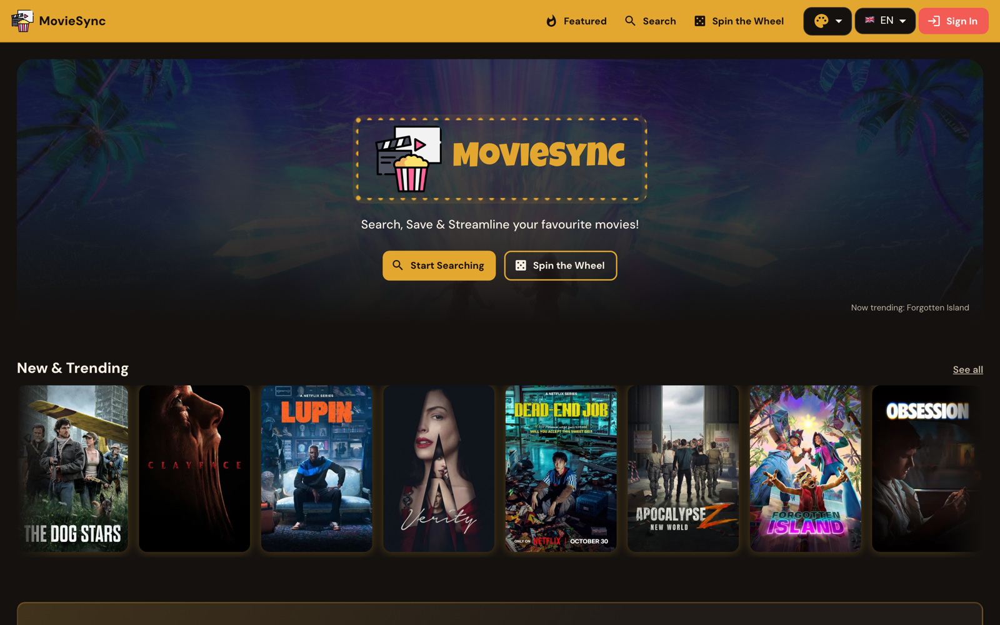

---

## What can I do with MovieSync?

MovieSync is built around the idea of having one place to manage your personal movie collection.

### Discover what's on

The home page opens on a backdrop from whatever is trending this week, with quick links to search or spin the wheel. Signed-in users see their shelf (how many titles are in each list) and an **Up next** row from their Watch Later list in place of the trending row.

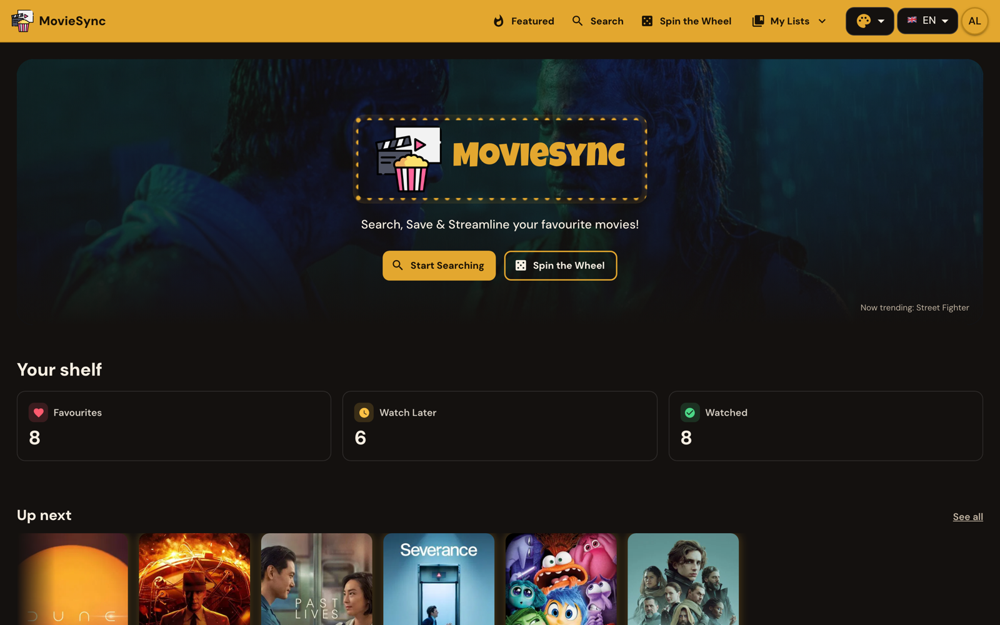

The **Featured** page groups titles into carousels: New & Trending, Romcoms, Horror Sensations, Sci-Fi & Fantasy Hits and Hidden Gems.

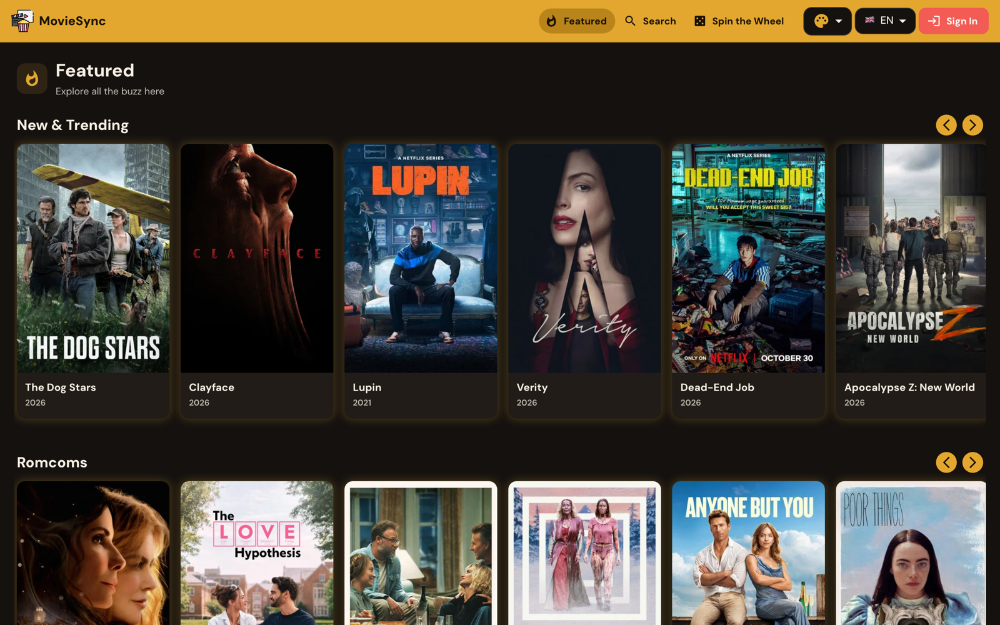

### Search movies and TV shows

Search the TMDB catalogue by title, optionally filtered by year and by type (movie or TV show).

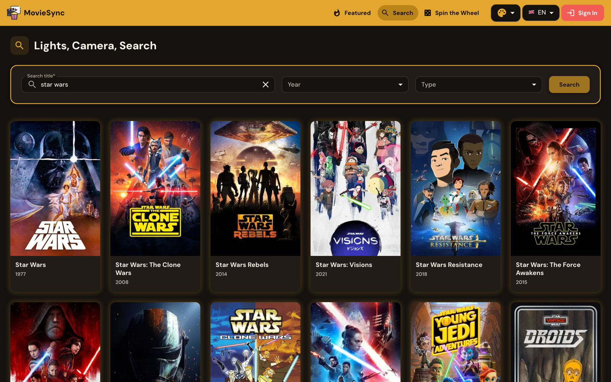

### See the details

Each title has its own page with the poster, genres, TMDB rating, a link to IMDb, the plot, and facts such as rating, release date, runtime, languages, box office, director, writers and cast. From here a signed-in user can add it to any of their lists in one click.

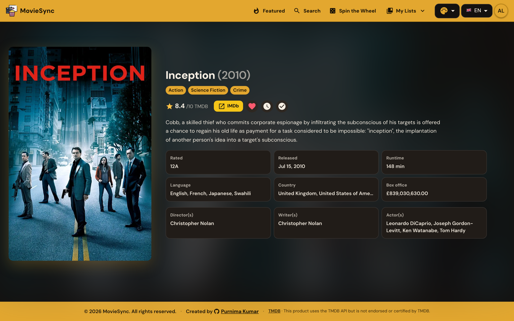

### Keep track of movies

Once signed in, a user can organise titles into three lists:

- **Favourites**: movies you really like
- **Watch Later**: movies you want to watch in the future
- **Watched**: movies you have already watched

| Favourites                          | Watch Later                           | Watched                       |
| ----------------------------------- | ------------------------------------- | ----------------------------- |
| 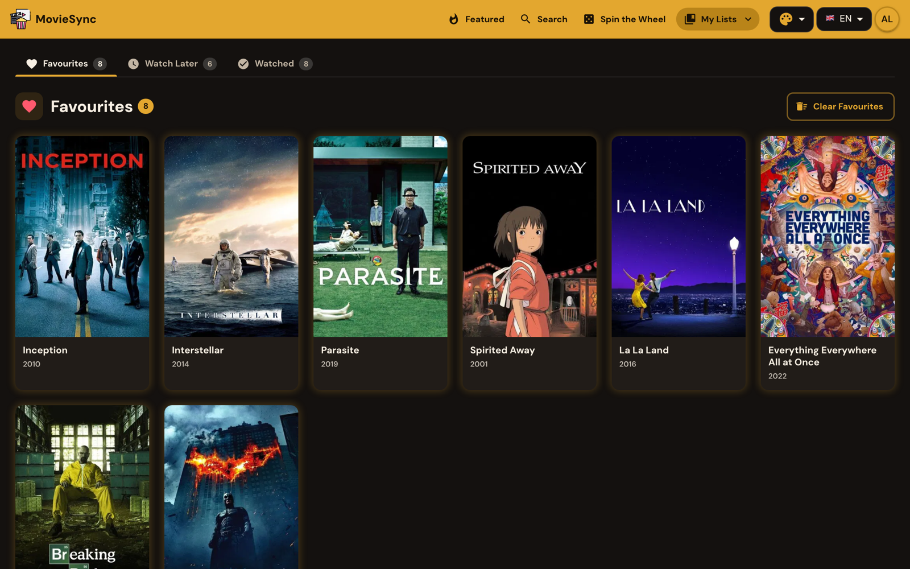 | 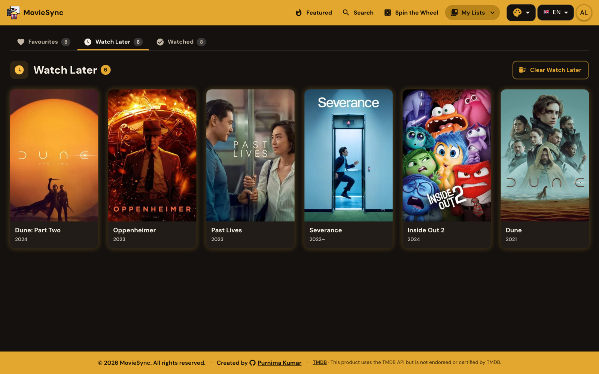 | 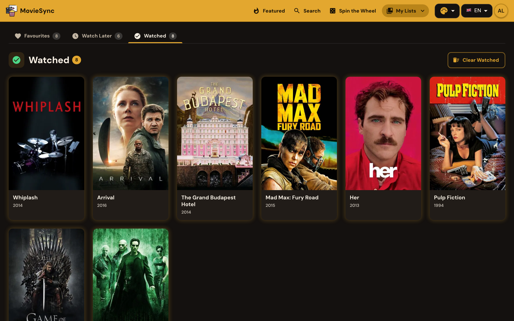 |

### Profile and statistics

The profile page turns your lists into a picture of your taste: totals and estimated watch time, highlights (top genre, favourite decade, most-saved director, highest-rated and oldest title) and charts of genres, release decades, ratings, languages, directors and actors.

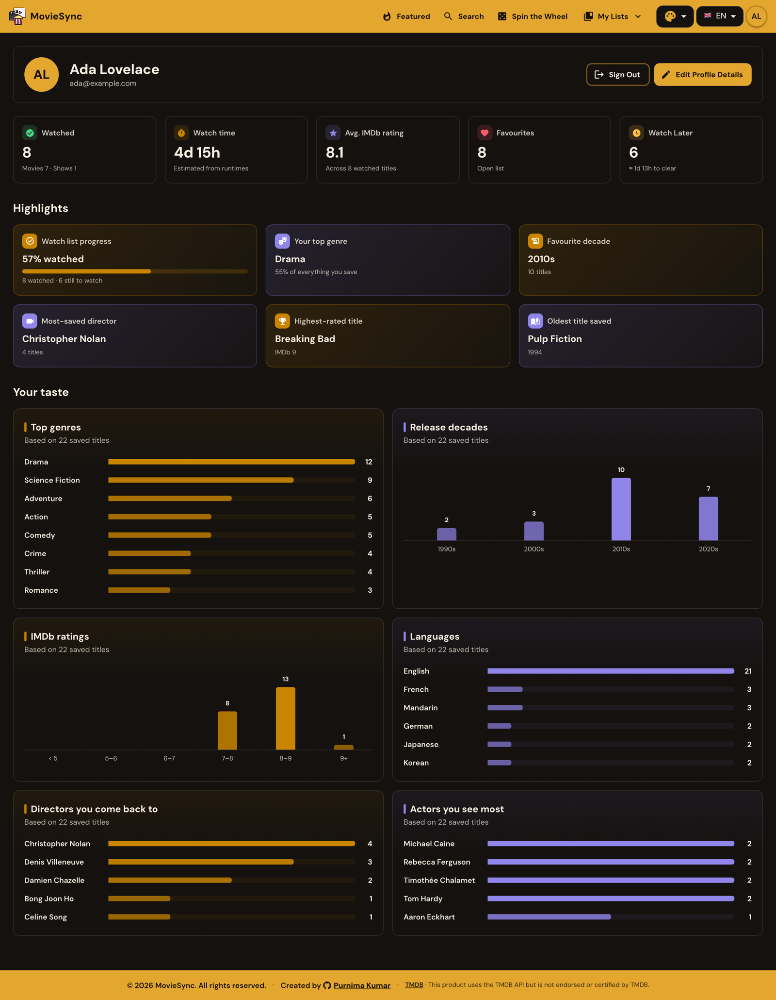

### Spin the Wheel

Sometimes you know you want to watch something but cannot decide what. The **Spin the Wheel** page picks for you, with filters for genre, type, release years, how many picks you want and whether to skip titles you have already watched.

It also has two smarter modes, both running entirely on free, self-hosted tools (no paid AI APIs):

- **Mood search**: type something like _"feel-good heist"_ or _"space survival"_ and the wheel picks from titles whose plots match the meaning, not just the keywords. Each movie's title, genre and plot are turned into an embedding by a small open-source model ([bge-small-en-v1.5](https://huggingface.co/BAAI/bge-small-en-v1.5)) running inside the API with Transformers.js, and stored in Postgres with **pgvector**. A search is a cosine-similarity query that takes a few milliseconds.
- **Smart Spin** (signed-in users): builds a taste profile from your lists (favourites count most, then watched, then watch later) and makes titles with your favourite genres, directors and actors more likely to come up. Every pick shows why it was chosen, for example _"Because you saved 2 films by Christopher Nolan"_.

Candidate posters sit on an animated wheel that slows down and stops with the winner under the pointer, followed by a detailed reveal and the rest of the shortlist. It respects the "reduce motion" accessibility setting. If the model is unavailable, the wheel falls back to random picks instead of failing.

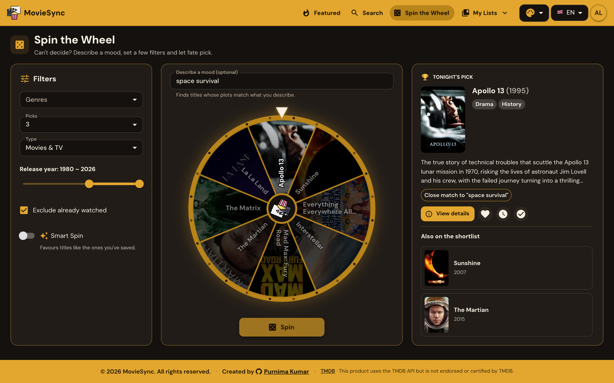

### Works on phones

Every page is responsive from 360px phones to 1920px desktops. On phones the top navigation becomes a bottom tab bar.

| Home                                      | Movie details                                       | Spin the Wheel                                                |
| ----------------------------------------- | --------------------------------------------------- | ------------------------------------------------------------- |
| 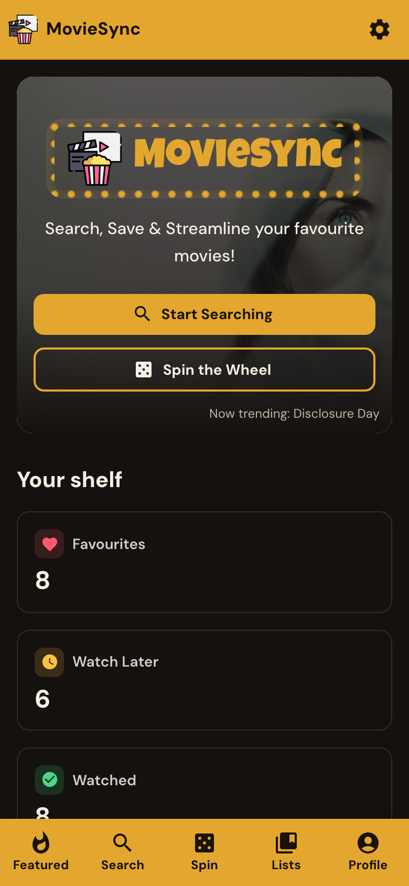 | 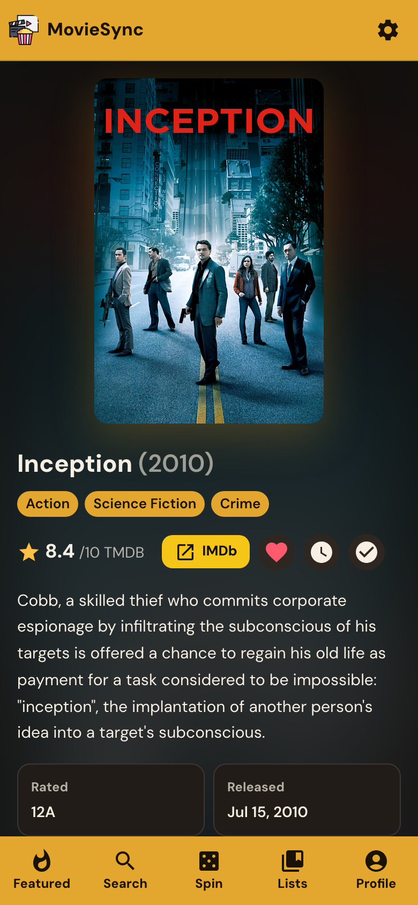 | 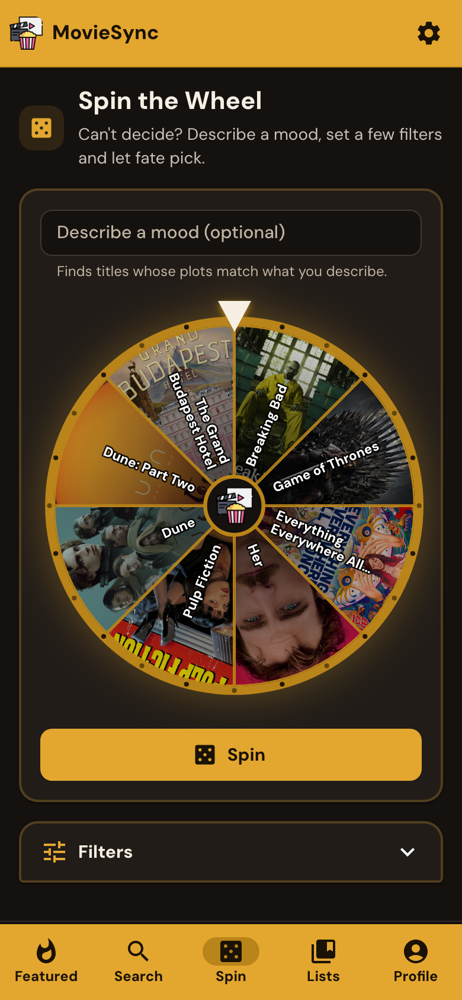 |

### Themes and languages

- **Themes**: pick from several colour palettes from the palette menu. Broadway Lights (shown in these screenshots) is the default.
- **Languages**: the interface is translated with **i18next** and **react-i18next** into English, French, Italian, Hindi and Japanese.

### Authentication

Personal lists are tied to the signed-in user. The frontend signs in with **OpenID Connect (OIDC)** through `react-oidc-context` (Auth0), and the API verifies the tokens on every request.

---

# A simplified view of the application

```text
                 ┌─────────────────────┐
                 │      MovieSync      │
                 │   React Frontend    │
                 └──────────┬──────────┘
                            │
                 API requests / responses
                            │
                 ┌──────────▼──────────┐
                 │    Express API      │
                 │   Node + TypeScript │
                 └───────┬───────┬─────┘
                         │       │
              ┌──────────▼─┐   ┌▼─────────────┐
              │ PostgreSQL │   │    TMDB API  │
              │ + pgvector │   │ Movie data   │
              └──────▲─────┘   └──────────────┘
                     │ embeddings
              ┌──────┴──────────────┐
              │ Embedding model     │
              │ (Transformers.js,   │
              │  runs in the API)   │
              └─────────────────────┘
```

The frontend handles the user interface and application state. The backend provides API endpoints and handles database operations, while the TMDB API provides movie and TV information. When a movie is cached, the API also stores an embedding of its plot so the spin wheel can search by mood.

---

# Tech Stack

MovieSync has a separate frontend and backend.

## Frontend

- **React 19** – building the user interface
- **TypeScript** – type-safe development
- **Vite** – development server and build tool
- **Material UI (MUI)** – UI components and styling
- **React Router** – application routing
- **Redux Toolkit** – managing application state
- **Redux Persist** – persisting selected Redux state
- **Axios** – making API requests
- **React i18next / i18next** – internationalization
- **Formik + Yup** – forms and validation
- **MUI X Charts** – charts and statistics
- **Framer Motion** – animations
- **Embla Carousel / Swiper / React Slick** – carousels and sliders

## Backend

- **Node.js** – server-side JavaScript runtime
- **Express** – REST API framework
- **TypeScript** – type-safe backend development
- **PostgreSQL** – relational database
- **node-postgres (`pg`)** – PostgreSQL connection and queries
- **JWT / JWKS** – authentication token verification
- **Axios** – external API communication
- **Express Rate Limit** – basic API rate limiting
- **Swagger** – API documentation
- **Nodemon** – development workflow
- **pgvector** – vector similarity search in PostgreSQL
- **Transformers.js** – runs the embedding model locally, no external AI service
- **node-pg-migrate** – versioned SQL migrations

## Testing and tooling

- **Vitest** – test runner for both frontend and backend
- **Supertest** – HTTP integration tests against a real PostgreSQL database
- **React Testing Library** – component tests
- **Docker / Docker Compose** – one-command local stack
- **GitHub Actions** – CI for lint, type checks, tests, builds and the Docker image

## External services

- **TMDB API** – movie and TV information, search, trending and discovery
- **PostgreSQL database** – storing user and movie-related data
- **Vercel** – frontend deployment

---

# Getting started

## With Docker (recommended)

1. Copy the example environment files and fill in your Auth0, TMDB and key values:

   ```bash
   cp backend/.env.example backend/.env
   cp frontend/.env.example frontend/.env
   ```

2. Start everything:

   ```bash
   docker compose up --build
   ```

   This starts PostgreSQL (with pgvector) on port 5433, the API on port 80 (set `API_PORT` to change it) and the frontend on http://localhost:5173. Migrations are not run automatically, so apply the schema yourself first (see below). The API downloads the embedding model (about 33 MB) the first time.

## Without Docker

Requires Node.js 24 and PostgreSQL with the `pgvector` extension (`brew install pgvector` on macOS).

```bash
# backend
cd backend
npm install
npm run migrate              # create or update the database schema
npm run backfill:embeddings  # optional: embed movies cached before mood search existed
npm run serve                # compiles and restarts on changes

# frontend (in another terminal)
cd frontend
npm install
npm run dev
```

---

# Testing

```bash
cd backend && npm test    # integration tests; needs a PostgreSQL test database
cd frontend && npm test   # unit and component tests
cd frontend && npm run test:e2e   # responsive checks in a real browser (Playwright)
```

The responsive suite builds the app, mocks the API and opens every main page (including signed-in pages, via a stored test session) at seven screen sizes from 360px phones to 1920px desktops. It fails if anything causes horizontal scrolling or if any visible text is smaller than 12px, and saves a screenshot of each page and size.

Backend tests run against a real PostgreSQL database (`moviesync_test` by default, or `TEST_DATABASE_URL`). They sign their own JWTs and encrypt request bodies exactly like the frontend, so the real authentication and decryption middleware is exercised. The embedding model is mocked so tests never download it. Add `:coverage` (e.g. `npm run test:coverage`) for a coverage report.

GitHub Actions runs linting, type checks, both test suites, the production builds and a Docker build on every push and pull request.

### Deployment

I also used the project to learn about deploying a full-stack application, configuring environment variables, handling production builds, and troubleshooting issues that only appear after deployment.

---

# Some interesting implementation areas

## State management with Redux Toolkit

MovieSync has several pieces of state that need to be shared across different parts of the application, such as:

- User information
- Favourites
- Watch Later movies
- Watched movies
- Featured movies

Redux Toolkit is used to keep this state organized and make updates predictable.

## Authentication and user initialization

When an authenticated user enters the application, MovieSync initializes the corresponding user in the backend if required and then loads their saved movie lists.

This created a useful real-world example of connecting an authentication system with application-specific user data.

## Movie data and personal data are kept separate

The movie information comes from the TMDB API, while personal actions such as marking a movie as favourite or watched are stored in the application's PostgreSQL database.

This separation is useful because the application does not need to store an entire movie database of its own just to let users maintain personal lists.
